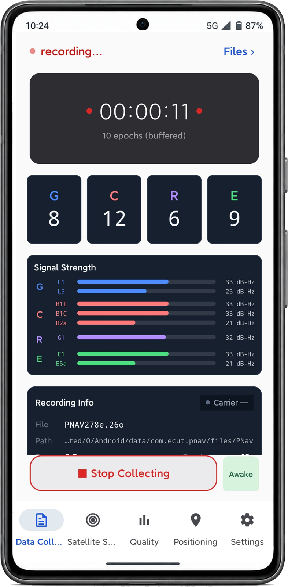
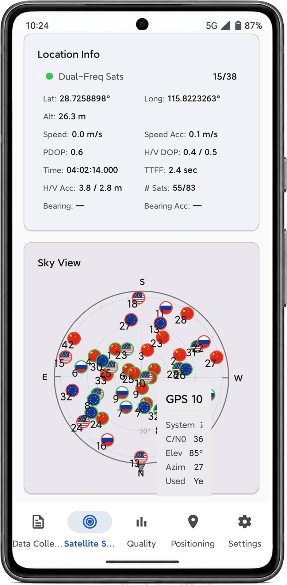
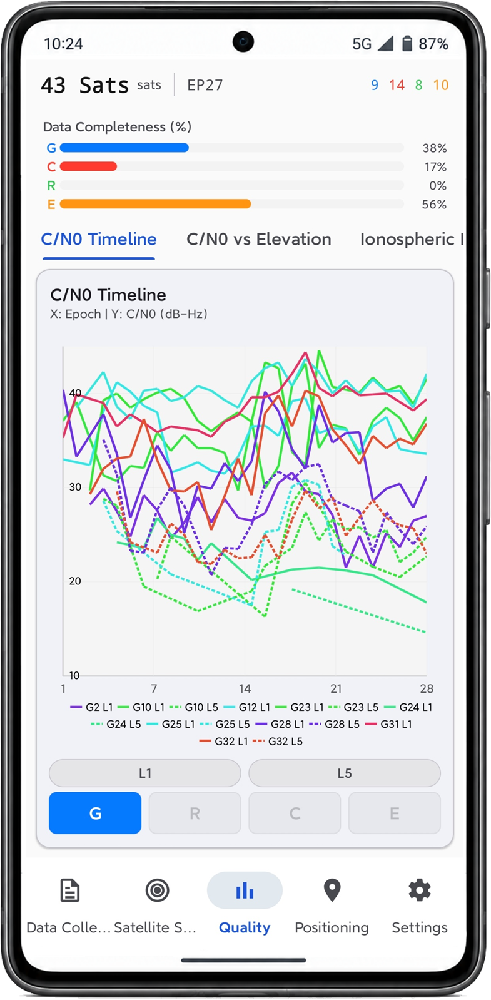
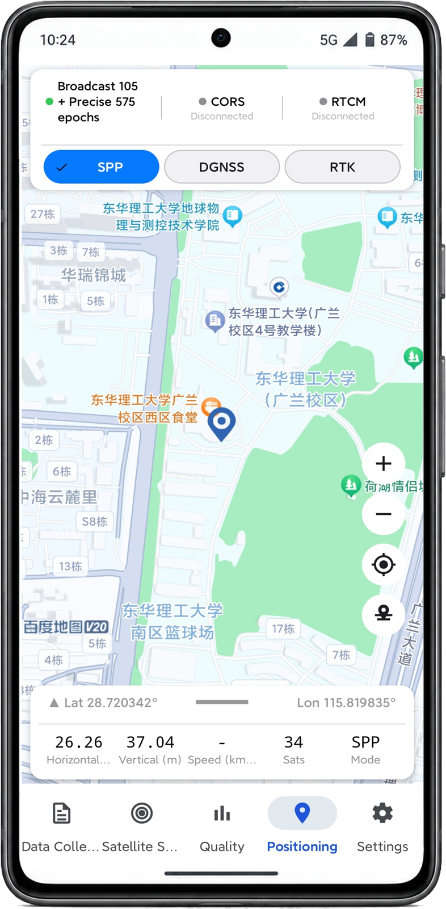

# P-Nav

**P-Nav (Pedestrian Navigation)** is an open-source Android platform for smartphone GNSS data acquisition, multi-mode real-time positioning, and on-device observation quality monitoring.

P-Nav builds on the open-source [myGNSS](https://github.com/z1Yang-1/myGNSS) application and integrates a Java implementation of [RTKLIB](https://github.com/tomojitakasu/RTKLIB) v2.4.3 as an inspectable, in-project positioning core.

---

## Features

| Category | Capability |
|---|---|
| **Positioning** | SPP, DGNSS, RTK (double-difference EKF with LAMBDA ambiguity resolution) |
| **Constellations** | GPS, GLONASS, Galileo, BDS, QZSS |
| **Frequencies** | L1/L2/L5 (GPS), G1/G2 (GLONASS), E1/E5b/E5a (Galileo), B1I/B1C/B2b/B2a (BDS) |
| **Ephemeris** | Broadcast RINEX 3/2 via FTP; precise SP3/CLK products |
| **Corrections** | NTRIP / CORS real-time RTCM streams decoded in native code |
| **Quality monitoring** | Native engine: MP1/MP5 multipath, three-criterion cycle-slip detection, pseudorange & carrier-phase noise, C/N0 distribution, ionospheric delay rate |
| **Data export** | RINEX 3.04 observation files, GnssLogger-compatible CSV, SQLite records |

---

## Screenshots

<table>
  <tr>
    <td align="center"><br><sub>Data collection</sub></td>
    <td align="center"><br><sub>Satellite status</sub></td>
    <td align="center"><br><sub>Quality analysis</sub></td>
    <td align="center"><br><sub>Positioning</sub></td>
  </tr>
</table>

---

## Architecture

```
GnssMeasurement ──► Observation adapter ──┬──► Java positioning core ──► solution ──► UI / SQLite
                                          │                        │
                                          │                        └──► RINEX 3.04 / CSV
                                          └──► native quality engine ──► report / time series
```

| Layer | Location | Contents |
|---|---|---|
| Acquisition | `com.ecut.pnav.MainActivity` | Single registration point for `GnssMeasurementsEvent`, `GnssStatus`, NMEA (API 24–34) |
| Observation adapter | `com.ecut.pnav.ui.measure_util` | `GnssMeasurement` → RTKLIB `obsd_t`, quality gating |
| Positioning core | `com.rtklib` (79 files) | SPP, DGNSS, RTK, post-processing, RINEX I/O |
| Native layer | `app/src/main/cpp` | RTCM 2/3 decoding, self-developed quality engine, JNI bridge |
| Data & services | `com.ecut.pnav.ui.data`, `ui/Ntrip` | Recording service, NTRIP service, RINEX/CSV/SQLite output |

The Java and native layers are connected by 10 JNI functions: 5 for NTRIP/RTCM and 5 for the quality engine.

---

## Install

A prebuilt APK is included so the app can be installed without building it:

```
release/P-Nav-v1.0.0-debug.apk
```

1. Transfer the APK to an Android device (Android 9 / API 28 or newer).
2. Allow installation from unknown sources when prompted.
3. Launch P-Nav and grant location permission.

> This is a **debug-signed** build: it installs and runs normally, but Android
> will label it as a debug build and it is not optimized for release. Builds
> signed with your own key will not share the bundled Baidu map API key — see
> [`app/libs/README.md`](app/libs/README.md).

## Requirements
- **Android Studio** Koala or newer (AGP 8.x)
- **JDK 17**
- **Android SDK** 34 (compileSdk/targetSdk), **minSdk 28**
- **NDK 26.1.10909125** with **CMake 3.22.1** (for `libpnav.so`)
- Target ABIs: `arm64-v8a`, `armeabi-v7a`

---

## Build

### 1. Clone

```bash
git clone <this-repository-url>
cd P-Nav
```

### 2. Create `local.properties`

Create `local.properties` in the project root. It is ignored by Git and must never be committed.

```properties
sdk.dir=/path/to/Android/Sdk

# --- Optional: release signing ---
# Leave these empty to build unsigned release builds / debug builds.
RELEASE_STORE_FILE=../release.keystore
RELEASE_STORE_PASSWORD=
RELEASE_KEY_ALIAS=
RELEASE_KEY_PASSWORD=
```

A template is provided as `local.properties.example`.

### 3. Build

```bash
# Debug
./gradlew assembleDebug

# Release (requires signing configuration)
./gradlew assembleRelease
```

The debug APK is written to:

```
app/build/outputs/apk/debug/app-debug.apk
```

> The Baidu LBS Android SDK is bundled in `app/libs/` and `app/src/main/jniLibs/`,
> so no extra download is needed to compile. The bundled API key only works for
> builds signed with the maintainers' certificate — see
> [`app/libs/README.md`](app/libs/README.md) if you sign with your own key.

---

## Usage

1. **Data collection** — start recording, verify the epoch rate, epoch count, and per-constellation signal strength.
2. **Satellite status** — check satellite geometry and visibility on the skyplot.
3. **Quality analysis** — inspect C/N0, multipath, and cycle slips to judge current observation conditions.
4. **Positioning** — select the correction source (CORS / RTCM) and the positioning mode, then observe the real-time solution.

Recorded observations and solutions can be exported as RINEX 3.04 and CSV for post-processing.

A detailed user manual (Chinese) covers installation, every interface page, NTRIP configuration, solving parameters, ephemeris download and the quality metrics with their formulas: [`docs/MANUAL_zh.md`](docs/MANUAL_zh.md).

---

## Test data

The observations and RTKLIB solutions behind the validation results are
included under [`results/`](results/README.md):

```
results/
├── common/      base-station observation + broadcast ephemeris
├── static/      rover observation and solutions
└── kinematic/   rover observation, IE PPK reference, solutions
```

Both sessions were recorded on 2026-09-23 with a Google Pixel 7 and a CHCNAV i87
base station (≈130 m baseline, 1 Hz). See [`results/README.md`](results/README.md)
for processing settings and file formats.

## RINEX output notes
P-Nav writes RINEX 3.04 observation files. When comparing against other tools, note that:

- **BDS B2a** is written with tracking code `5P` (the valid codes for B2a are `5D`, `5P` and `5X`).
- **BDS B1I** is recorded in RINEX frequency band **2**, not band 153 as a naive `round(f / 10.23 MHz)` conversion would suggest.

---

## Third-party components

See [`THIRD-PARTY-NOTICES.md`](THIRD-PARTY-NOTICES.md) for licenses and attribution.

---

## Contact

Developed and maintained by **L-TEAM**, East China University of Technology.

Technical support: <lglu@ecut.edu.cn>

---

## License

P-Nav is released under the **BSD 2-Clause License**. See [`LICENSE`](LICENSE).

---

## Acknowledgements

- [RTKLIB](https://github.com/tomojitakasu/RTKLIB) by T. Takasu — GNSS processing engine
- [myGNSS](https://github.com/z1Yang-1/myGNSS) by Jin et al. — the open-source Android application this work builds upon
- Google GnssLogger — reference for Android raw measurement logging conventions
