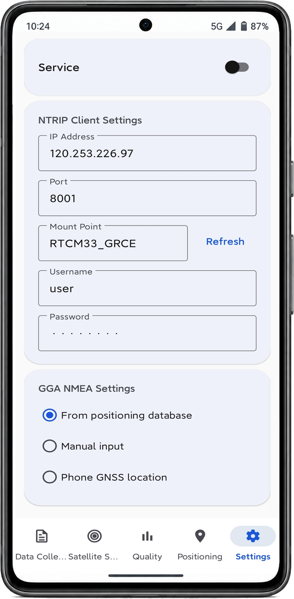
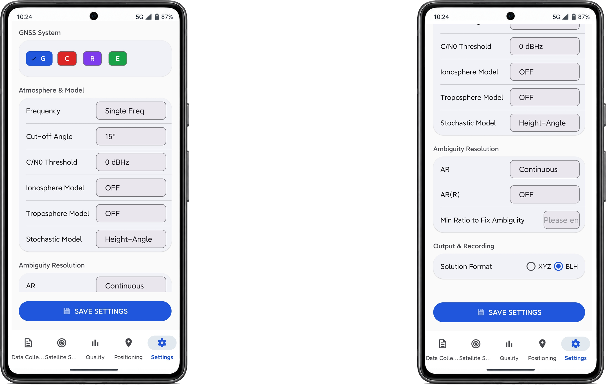

# P-Nav 用户手册

面向 Android 智能手机的 GNSS 数据采集、多模式定位与观测质量分析平台

L-TEAM · 华东理工大学　技术支持：lglu@ecut.edu.cn

---

## 1. 概述

P-Nav 是把智能手机当作 GNSS 测量仪器使用的一体化软件。它从 Android 系统的原始观测接口取得伪距、载波相位、多普勒与载噪比，在设备上实时完成三类解算，并对观测质量做逐历元分析，最终可导出标准格式文件供后处理使用。

| 能力 | 说明 |
|---|---|
| 定位模式 | 单点定位（SPP）、差分定位（DGNSS）、实时动态定位（RTK） |
| 星座 | GPS、GLONASS、北斗、Galileo、QZSS |
| 频点 | L1/L2/L5、B1I/B1C/B2b/B2a、E1/E5a/E5b、G1/G2 |
| 质量分析 | 多路径 MP1/MP2/MP5、周跳检测、载波相位噪声、C/N₀、电离层延迟率 |
| 数据导出 | RINEX 3.04 观测文件、GnssLogger 兼容 CSV |

> PPP 解算路径在代码中存在，但尚未达到稳定可用的水平，本版本不提供该功能。

---

## 2. 安装与首次启动

**要求**：Android 9（API 28）及以上。

1. 将 `P-Nav-v1.0.0-debug.apk` 传到手机；
2. 允许"安装未知来源应用"，完成安装；
3. 首次启动会弹出**语言选择**（中文 / English），选定后界面立即切换，之后不再询问；
4. 按提示授予**定位权限**（必需）与存储权限（用于导出）。

> 若手机上已装有不同签名的旧版本，需先卸载再安装。

---

## 3. 界面与工作流

底部导航分为五页：**数据采集、卫星状态、质量分析、定位、设置**。

典型使用流程：

```
数据采集页 → 开始录制 → 确认速率与信号强度
     ↓
卫星状态页 → 检查卫星几何与可见性
     ↓
质量分析页 → 判断当前观测质量是否适合高精度解算
     ↓
定位页 → 配置改正源与模式 → 观察实时结果
     ↓
停止采集 → 导出 RINEX / CSV
```

全部环节在同一应用内完成，无需外部软件介入。

---

## 4. 数据采集页

**顶部**：录制状态与文件入口。

**计时区**：已录时长与已缓冲历元数。1 Hz 采样下，历元数应约等于秒数；若明显偏小，说明观测回调未按预期到达。

**星座磁贴**：当前参与定位的卫星数（G / C / R / E）。

**信号强度**：逐卫星、逐频点的 C/N₀ 条形图，按星座着色。用于在采集过程中即时发现某颗卫星或某个频点信号异常。

**录制信息**：输出文件名与当前文件大小。

> 采集期间 GNSS 观测会先缓冲在内存中，停止时才统一写入 RINEX 文件。因此**采集时间越长，停止处理所需时间越长**，请耐心等待"正在生成"完成，不要强制退出应用。

---

## 5. 卫星状态页

**定位信息卡**：双频卫星数、经纬度与椭球高、速度、PDOP 与 H/V DOP、定位时间与 TTFF、水平/垂直精度、参与解算的卫星数。

**星空图（Skyplot）**：以极坐标显示各卫星的方位角与高度角，按星座着色。点击卫星可查看其系统、C/N₀、高度角、方位角及是否参与解算。

判断要点：卫星应大致均匀分布于整个天球；若集中在某一侧，几何构型差，PDOP 会变大，定位精度下降。

---

## 6. 质量分析页

这是 P-Nav 的核心功能。所有指标**逐历元**计算，可在采集过程中实时观察。

### 6.1 数据完整率

各星座实际收到观测的历元占应有时段的比例。数值偏低说明该星座卫星可见性差或频繁失锁。

### 6.2 载噪比 C/N₀

按频点统计的载噪比分布，并按时序绘制。C/N₀ 是判断信号强弱最直接的指标：

| C/N₀ | 判断 |
|---|---|
| > 40 dB-Hz | 良好 |
| 30–40 dB-Hz | 可用 |
| 20–30 dB-Hz | 偏弱，易受多路径与周跳影响 |
| < 20 dB-Hz | 微弱，通常不应参与高精度解算 |

软件同时给出 **C/N₀ 与高度角的关系**——低高度角卫星 C/N₀ 偏低属正常现象，若同高度角下明显低于其他卫星，则提示该方向存在遮挡或多路径。

### 6.3 多路径 MP1 / MP2 / MP5

多路径指卫星信号经建筑物、地面、水面反射后与直达信号叠加造成的测距误差。传统做法是计算码减相位组合（CMC），但 **Android 的载波相位是相对量**（自锁定时刻起累积），绝对值不可用。

因此 P-Nav 采用**时间差分累积法**。对同一卫星相邻两历元取差分：

$$\Delta MP_1 = \Delta P_1 - a_1 \Delta L_1 + a_2 \Delta L_2$$

$$\Delta MP_2 = \Delta P_1 - c_1 \Delta L_1 + a_1 \Delta L_2$$

其中 $\alpha = (f_1/f_2)^2$，各系数为：

$$a_1 = \frac{\alpha+1}{\alpha-1},\quad a_2 = \frac{2}{\alpha-1},\quad c_1 = \frac{2\alpha}{\alpha-1}$$

差分消去了载波相位的未知锁定初值，沿弧段累积即得到 MP 序列。由于累积量中仍含整周模糊度造成的常数偏置，软件再扣除当前弧段的运行均值，仅保留残差：

$$r_i = MP_i - \overline{MP}_{\text{arc}}$$

最后按系统统计残差的均方根：

$$MP_{\text{RMS}} = \sqrt{\frac{1}{N}\sum_{i=1}^{N} r_i^2}$$

**判读标准**：

| MP_RMS | 含义 |
|---|---|
| < 0.3 m | 良好，观测环境开阔 |
| 0.3–0.6 m | 一般，存在轻度多路径 |
| > 0.6 m | 较差，多路径影响明显 |

> **关于 MP2**：多数手机 GNSS 芯片只跟踪 L1+L5（或 L1+L2C），L2 观测往往缺失，因此界面主要呈现 **MP1 与 MP5**。内部仍计算 MP2，但在缺少 L2 数据时其结果无意义。
>
> **关于 MP5 的一个实现细节**：同一卫星的 L1 与 L5 伪距在物理上必然相等（几何距离唯一），但 Android 对不同信号分量独立跟踪，两个分量上报的伪距可能不一致。本软件在双频组合时强制取 $P_{L5} = P_{L1}$，避免引入虚假的多路径项。

### 6.4 周跳检测（三判据）

周跳是载波相位计数发生整周跳变的现象，会破坏整周模糊度、使定位解算失效。单一判据在手机数据上误报率过高，因此 P-Nav 联合使用三个判据：

**① 几何无关组合（GF）差分**

$$GF = L_1 - L_2,\qquad d_{GF} = GF_k - GF_{k-1}$$

若 $|d_{GF}| > 0.30$ m，判为周跳。

**② GF 多项式残差**

对最近 10 个历元的 GF 序列拟合二次多项式，取末历元的拟合残差：

$$r_k = GF_k - \hat{GF}_k$$

若 $|r_k| > 0.05$ m，判为周跳。该判据对缓变型周跳更敏感。

**③ Melbourne–Wübbena 递归检验**

MW 组合同时使用相位与伪距，可消除几何距离、钟差与电离层影响：

$$\Phi_{WL} = \frac{L_1}{\lambda_1} - \frac{L_2}{\lambda_2},\qquad P_{NL} = \frac{f_1 P_1 + f_2 P_2}{f_1 + f_2}$$

$$MW = \Phi_{WL} - \frac{P_{NL}}{\lambda_{WL}},\qquad \lambda_{WL} = \frac{c}{f_1 - f_2}$$

在无周跳的弧段内 MW 应接近常数。软件递归估计其均值与方差，若新历元偏离超过 $4\sigma$，判为周跳：

$$|MW_k - \overline{MW}| > 4\sigma_{MW}$$

三者任一触发即复位该卫星的模糊度弧段（CMC 弧段与三差参考），但**不重置多路径弧段**——原因见 6.6。

### 6.5 载波相位噪声（三差法）

依据国家标准 BD 420022-2019（§6.5/6.6），以三差观测量估计噪声。三差对相邻历元连续做三次差分，可消除钟差与几何距离，仅保留观测噪声：

$$\sigma = \sqrt{\frac{\sum TD^2}{8N}}$$

伪距（TD-PR）与载波相位（TD-CP）分别统计，得到各系统的噪声水平。

### 6.6 CMC 去趋势

码减相位组合：

$$CMC = P - L$$

CMC 中包含两倍电离层延迟与整周模糊度构成的缓变趋势。软件用 120 历元的环形缓冲拟合**四次多项式**并取残差，从而分离出多路径与噪声：

$$CMC_{\text{resid}} = CMC_k - \hat{CMC}_k^{(4)}$$

### 6.7 电离层延迟率（IOD）

由 GF 组合的时间变化率换算得到：

$$IOD = \frac{d_{GF} \cdot f_2^2}{f_1^2 - f_2^2} \cdot \frac{1}{\Delta t}$$

该指标反映电离层电子含量的变化快慢，可用于判断电离层活动强度，也是识别野值的一种手段。

### 6.8 弧段质量 CSR

$$CSR = \frac{\text{历元数}}{\text{综合周跳数}}$$

数值越大表示观测连续性越好。单接收机条件下缺少外部基准，CSR 是评价数据可用性的一个便捷判据。

### 6.9 面向手机观测的三项专属适配

这是 P-Nav 质量引擎区别于常规 GNSS 分析软件之处，均源于 Android 原始观测的特性：

**① L5 不适用 GF 阈值判据**

手机通道间的频率间偏差（IFB）漂移使 L1/L5 的 GF 一阶差分远大于任何合理阈值。若施加 0.30 m 的固定阈值，会产生大量误报。因此对 L5 **只依据 `ADR_STATE` 状态位**（`RESET` / `CYCLE_SLIP`）判定周跳。

**② 新跟踪的 L2 需要预热**

信号重新捕获后的最初 5 个历元存在瞬时不一致，若立即施加 GF 检测会误判。软件在此期间跳过检测。

**③ 周跳不重置多路径弧段**

检测到周跳时，软件重置 CMC 弧段与三差参考，却**刻意保留多路径弧段**。原因：MP 累积量中的整周模糊度表现为常数偏置，而 6.3 的弧段均值扣除本身就能吸收这个跳变。若在周跳时一并重置，反而会在 MP 序列中引入一个虚假阶跃。

---

## 7. 定位页

### 7.1 模式选择

| 模式 | 说明 | 所需条件 |
|---|---|---|
| **SPP** | 单点定位，迭代加权最小二乘 | 仅需广播星历 |
| **DGNSS** | 差分定位，利用基准站伪距改正 | 需实时差分数据（RTCM） |
| **RTK** | 双差卡尔曼滤波 + 整周模糊度固定（LAMBDA 方法，ratio 检验） | 需实时差分数据（RTCM） |

模式通过页面顶部的分段选择器切换，可实时切换并观察结果变化。

### 7.2 改正源配置（NTRIP / CORS）

RTK 与 DGNSS 必须有差分改正数。P-Nav 支持通过 NTRIP 协议接入 CORS 网络。



**配置步骤**：

1. 自行向 CORS 服务商**购买账号**，会获得服务器地址、端口、挂载点、用户名、密码五项信息；
2. 在「设置 → NTRIP」页面依次填写：

| 字段 | 填写内容 |
|---|---|
| **IP Address** | 服务商提供的服务器地址 |
| **Port** | 服务商提供的端口（常见为 2101、8001 等） |
| **Mount Point** | 挂载点名称；可点 **Refresh** 从服务器拉取可用列表 |
| **Username** | 服务商分配的账号 |
| **Password** | 服务商分配的密码 |

3. 返回定位页，打开 **CORS** 开关；
4. 连接成功后页面顶部显示已接收的改正数据状态。

**GGA NMEA Settings**（图下半部分）决定向服务器回传哪种位置信息，多数 CORS 服务需要 GGA 语句才能分发对应区域的改正数：

| 选项 | 说明 |
|---|---|
| **From positioning database** | 使用应用内定位数据库中的最新结果（默认） |
| **Manual input** | 手动填写坐标 |
| **Phone GNSS location** | 使用手机系统定位 |

> NTRIP 账号由各家 CORS 服务商自行提供，P-Nav 不附带任何账号。账号的购买、计费与挂载点选择请咨询相应服务商。图中所示服务器与挂载点为测试时使用的一天期账号，仅供参考填写格式。

### 7.3 RTCM 直连

若手边有本地基准站，也可直接接收其 RTCM 数据流（不经 NTRIP 账号），打开 **RTCM** 开关并配置接收参数。

### 7.4 星历状态

页面顶部显示已加载的广播星历文件数与已通过的观测数，用于确认解算所需的数据是否就绪。

### 7.5 解算参数配置

解算参数在「**设置 → 解算设置**」中调整，保存后对后续解算生效。下图左侧为页面上半部分，右侧为同页向下滚动后的下半部分。



#### GNSS System

选择参与解算的星座（G / C / R / E，即 GPS、北斗、GLONASS、Galileo）。全部勾选为默认；若某星座观测质量差（例如质量分析页显示其数据完整率很低），可取消勾选以排除干扰。

#### Atmosphere & Model

| 参数 | 可选值 | 含义与建议 |
|---|---|---|
| **Frequency** | Single Freq / Dual Freq | 使用的频点数。双频可组成消电离层组合，精度更高，但需要设备同时跟踪两个频点。默认 Single Freq。 |
| **Cut-off Angle** | 0°–90°（5° 步进） | 高度角截止。低于该角度的卫星不参与解算。默认 15°；多路径严重的环境可提高到 20°–25°。 |
| **C/N0 Threshold** | 0–45 dB-Hz（5 dB 一档） | 载噪比门限，低于该值的观测被剔除。默认 0（不筛选）；建议设为 25–30 以排除弱信号。 |
| **Ionosphere Model** | OFF / Klobuchar / Iono-Free LC | 电离层改正方式。**OFF** 不做改正；**Klobuchar** 用广播模型，适用于单频；**Iono-Free LC** 用消电离层组合，需双频。 |
| **Troposphere Model** | OFF / Saastamoinen | 对流层改正。单点定位建议开启 Saastamoinen；双差相对定位中该项大部分被差分消除。 |
| **Stochastic Model** | Height-Angle / SNR | 观测随机模型。**Height-Angle** 按高度角定权（高角度卫星权重高，常规做法）；**SNR** 按载噪比定权，对城市环境更稳健。 |

> **关于电离层/对流层的 OFF**：代码中的内置默认值为 Klobuchar + Saastamoinen。截图所示为当前保存的配置（两项均为 OFF），这类设置常见于**差分相对定位**——双差已消去大部分电离层与对流层误差。做**单点定位**时建议开启这两项，否则绝对精度会明显下降。

#### Ambiguity Resolution

| 参数 | 可选值 | 含义 |
|---|---|---|
| **AR** | OFF / Continuous / Instantaneous / Fix and Hold | 全系统整周模糊度固定策略。**Continuous**（默认）跨历元持续估计模糊度，最常用；**Instantaneous** 每历元独立固定，对周跳不敏感但更难固定；**Fix and Hold** 固定后强约束，收敛快但错误固定时影响更大。 |
| **AR(R)** | OFF / On / Auto Cal | GLONASS 的独立模糊度固定开关（R 为 GLONASS 的 RINEX 系统字母）。GLONASS 采用频分多址，存在频间偏差，固定难度高于其他系统，通常保守设为 **OFF**。 |
| **Min Ratio to Fix Ambiguity** | 数值 | 判定"固定成功"的 ratio 阈值。ratio 为最优与次优整数解的残差平方和之比，越大越可靠。RTKLIB 常用 **3.0**；要求更严可设 4.0–5.0（固定率下降但错误固定减少）。 |

> 北斗的模糊度固定由程序内部默认开启，页面上不再单独提供开关。

#### Output & Recording

| 参数 | 可选值 | 含义 |
|---|---|---|
| **Solution Format** | XYZ / BLH | 解算结果的输出格式。**BLH** 为经纬高（默认，便于查看）；**XYZ** 为地心地固坐标（ECEF），适合后处理或与参考坐标比较。 |

点击底部 **SAVE SETTINGS** 保存。参数保存在应用本地，重启后仍生效。

---

## 8. 星历下载

解算需要卫星轨道信息。P-Nav 支持两种星历：

| 类型 | 用途 | 文件 |
|---|---|---|
| **广播星历** | SPP、DGNSS、RTK 的默认来源 | `BRDM` 混合导航文件（RINEX 3）或分系统文件 |
| **精密星历** | 提升 SPP 的轨道/钟差精度 | SP3 轨道 + CLK 钟差 |

### 8.1 数据来源

软件内置三个 FTP 服务器，按顺序自动切换：

| 顺序 | 服务器 | 说明 |
|---|---|---|
| 1 | `igs.gnsswhu.cn` | 武汉大学 IGS 数据中心（国内访问快，优先） |
| 2 | `igs.ensg.ign.fr` | 法国 IGN |
| 3 | `isdcftp.gfz-potsdam.de` | 德国 GFZ |

若前一个服务器超时或文件缺失，自动尝试下一个。下载过程显示文件名与大小；完成后自动解压 `.gz` 并清理过期文件（保留当天与前一天）。

### 8.2 使用要点

- **广播星历需联网下载当天数据**，建议在开始测量前先完成下载；
- **精密星历有延迟**（超快速产品约数小时），做实时测量时常不可用，仅适合事后处理；
- 下载界面会列出已存在的文件，可直接勾选删除。

---

## 9. 数据导出

### 9.1 RINEX 3.04 观测文件

默认命名格式 `PNAV<年积日><会话字母>.<年份后两位>o`，例如 `PNAV278e.26o` 表示 2026 年第 278 天的第 e 个会话。

文件包含：
- 文件头：版本、测站与接收机信息、概略位置、观测类型声明、各频点载波相位偏移
- 观测数据：逐历元的多系统多频观测值

**观测码说明**（易错处）：

| 系统 | 频点 | 观测码 |
|---|---|---|
| BDS | B1I | `2I` |
| BDS | B1C | `1P` |
| BDS | B2b | `7Z` |
| **BDS** | **B2a** | **`5P`** |

> 北斗 B2a 的合法跟踪码为 `5D` / `5P` / `5X`，**不含 `5Q`**（`5Q` 属 GPS L5 与 Galileo E5a）。部分公开的 GnssLogger→RINEX 转换工具在 B2a 分支误用了 `5Q`，使用这些工具生成的文件在严格的 RINEX 读取软件中可能被拒绝。

### 9.2 CSV 日志

采用与 Google GnssLogger 一致的表结构（Raw / Fix / NMEA / Nav / Status），可直接用既有分析工具打开。

### 9.3 文件位置

默认保存在应用私有目录：

```
/Android/data/com.ecut.pnav/files/PNav/
```

可通过数据线、文件管理器或应用内的"文件"入口访问。应用日志另存于同级的 `PNav/logs/`。

---

## 10. 常见问题

**Q：开始采集后历元数不增长？**
检查定位权限是否已授予；部分机型需要在系统设置中额外开启"精确位置"。

**Q：卫星数很多但定位精度差？**
查看 PDOP。卫星集中在天球某一侧会使 PDOP 增大，几何构型差。也可在质量分析页查看是否存在低 C/N₀ 卫星拉低整体质量。

**Q：RTK 一直无法固定（ratio 不达标）？**
常见原因：① 未接入改正数据；② C/N₀ 偏低或多路径严重；③ 手机仅跟踪 L1+L5（而非测绘常见的 L1+L2），L5 的通道间偏差会使模糊度更难固定；④ 动态场景下周跳频繁。可先在质量分析页确认观测条件。

**Q：停止采集后卡住很久？**
采集期间观测缓冲在内存中，停止时统一写出。记录时间越长，处理越久。请等待完成，不要强制退出。

**Q：导出的 RINEX 在其他软件中读不出 BDS？**
确认对方软件支持的 RINEX 版本与观测码。早期版本导出的 B2a 使用了不合规的 `C5Q`，请用当前版本重新导出（当前版本写 `C5P`）。

**Q：地图不显示？**
百度地图 SDK 的 AK 与签名证书绑定。用不同证书签名的构建需要自行申请 AK，详见仓库 `app/libs/README.md`。

---

## 附录：质量指标一览

| 指标 | 符号 | 单位 | 判据 |
|---|---|---|---|
| 载噪比 | C/N₀ | dB-Hz | >40 良好 |
| 多路径 | MP1/MP2/MP5 | m | <0.3 良好 |
| 周跳 | GF / GF-poly / MW | 事件数 | 阈值 0.30 m / 0.05 m / 4σ |
| 载波相位噪声 | σ_CP | cycles 或 m | 越小越好 |
| 伪距噪声 | σ_PR | m | 越小越好 |
| 电离层延迟率 | IOD | m/s | 反映电离层活动 |
| 弧段质量 | CSR | 历元/周跳 | 越大越好 |
